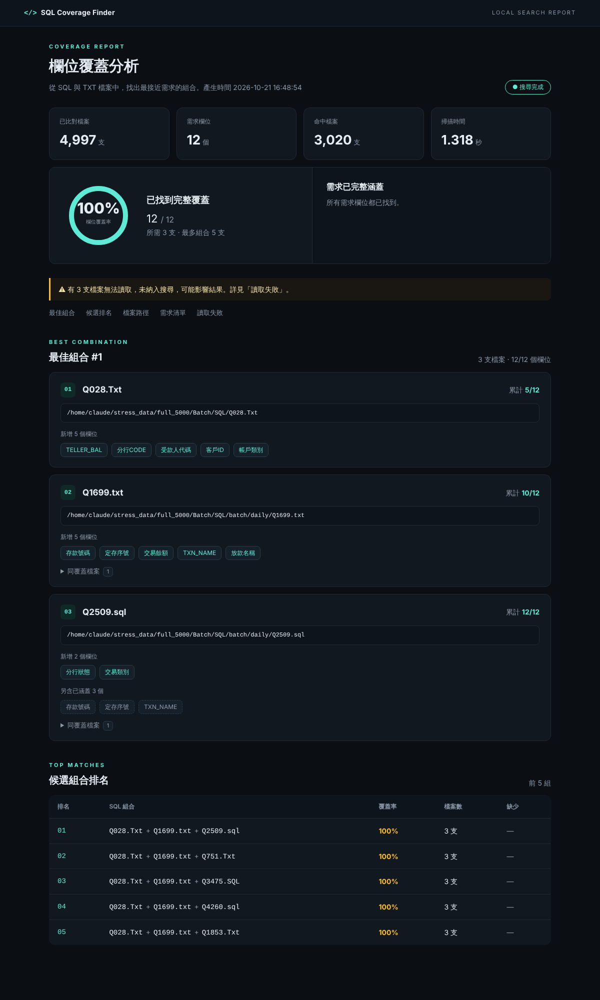
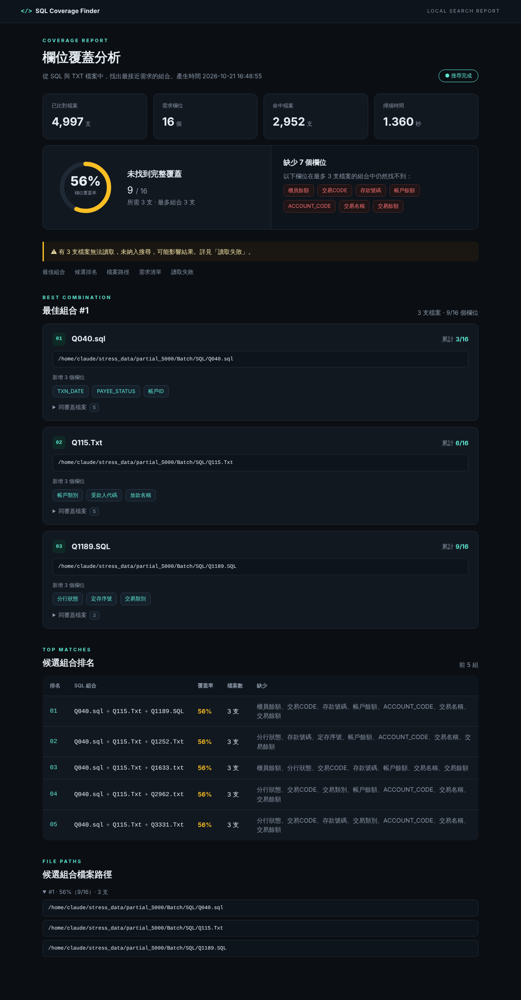

# SQL Coverage Finder

**找出最少幾支 SQL／TXT 檔案，就能涵蓋你指定的全部欄位，並告訴你檔案在哪裡。**

你手上有幾百、幾千支舊 SQL，主管要一張報表需要 10 個欄位，你不想一支一支打開找。
把資料夾和欄位清單給它，幾秒內告訴你：哪 2～3 支 SQL 合起來就有全部欄位、每支貢獻哪些欄位、還缺什麼、完整路徑在哪。

- 只需要 Python 3.11+，**不用安裝任何套件**，Windows 雙擊 `run.bat` 就能跑。
- 欄位可以是**中文、英文或中英混合**（`交易序號`、`ACCOUNT_NO`、`客戶ID`）。
- 不連網、不連資料庫、不解析 SQL，純文字比對，只讀你指定的資料夾。
- 結果顯示在畫面並寫入 `result.txt`；設定 `html = true` 還會產生暗色主題的 `report.html`。
- 5000 支檔案約 2 秒，10000 支約 4 秒，而且保證是精確最佳解。



## 快速開始

1. 下載或 clone 這個專案。
2. 用記事本打開 **`config.toml`**，填入資料夾與欄位：

   ```toml
   # 要掃描的資料夾（含子目錄）。Windows 路徑請用「單引號」
   folders = [
     'U:\Project\SQL',
     'U:\Batch\SQL',
   ]

   # 需求欄位：中文、英文、中英混合都可以
   fields = [
     "交易序號",
     "帳號",
     "交易金額",
     "ACCOUNT_NO",
     "BRANCH_CODE",
   ]

   max_files = 5          # 一組最多幾支檔案
   top = 5                # 顯示前幾組結果
   html = false           # 改成 true 會另外產生 report.html
   ```

3. **雙擊 `run.bat`**。結果顯示在畫面上，同時寫入 `result.txt`。想要圖表化的報告，把 `config.toml` 的 `html` 改成 `true`，就會另外產生 `report.html` 並自動開啟。

## 設定檔 config.toml

所有設定集中在一個檔案，用 Python 3.11 內建的 TOML 格式（不需安裝套件），可以寫註解和中文，存成 UTF-8 或 UTF-8 (BOM) 都可以。

| 項目 | 說明 | 預設 |
|---|---|---|
| `folders` | 要掃描的資料夾清單，會連同子目錄一起掃 | 必填 |
| `fields` | 需求欄位清單，中英文皆可，不分大小寫，重複會自動去除 | 必填 |
| `max_files` | 一組最多幾支檔案 | 5 |
| `top` | 顯示前幾組結果 | 5 |
| `extensions` | 要掃描的副檔名 | `[".sql", ".txt"]` |
| `output_dir` | `result.txt`（與 `report.html`）的存放資料夾，不存在會自動建立 | `"."`（目前資料夾） |
| `html` | 是否另外產生暗色主題的 `report.html`；`result.txt` 一定會產生。用 `run.bat` 執行時會自動開啟報告 | `false` |

> ⚠ **Windows 路徑一定要用單引號**：`'U:\Project\SQL'`。
> 用雙引號 `"U:\Project\SQL"` 時，`\P` 會被當成跳脫字元而報錯（程式會提示你改用單引號）。
> 欄位名稱用單引號或雙引號都可以。

想準備好幾組不同的查詢，就複製成多個設定檔，例如 `bank_report.toml`、`loan.toml`，再用 `run.bat loan.toml` 執行。

### 命令列（進階）

命令列參數會**覆蓋**設定檔中的值，適合臨時調整：

```bat
run.bat                               :: 使用 config.toml
run.bat loan.toml                     :: 使用其他設定檔
run.bat config.toml --top 10          :: 臨時改成顯示前 10 組
run.bat config.toml --html            :: 這次另外產生 report.html

python sql_coverage_finder.py                                  :: 自動讀取目前資料夾的 config.toml
python sql_coverage_finder.py --config loan.toml --max-files 3 --html --open
```

| 參數 | 說明 |
|---|---|
| `--config` | 設定檔路徑，預設 `config.toml` |
| `--max-files` / `--top` | 覆蓋 `max_files` / `top` |
| `--output-dir` | 覆蓋 `output_dir` |
| `--html` / `--no-html` | 覆蓋 `html` |
| `--open` | 產生 `report.html` 後自動用瀏覽器開啟（`run.bat` 已內建；直接執行 python 時預設不開啟） |

優先順序：**命令列 > 設定檔 > 預設值**。資料夾與欄位只能寫在設定檔裡，舊版的 `folders.txt`／`fields.txt` 已不再支援。

## 看懂輸出

```text
SQL Coverage Finder
===================
搜尋完成 · 4997 支檔案 · 16 個需求欄位 · 命中 2952 支
未找到完整覆蓋（最多 3 支檔案）

最佳覆蓋率 : 56% (9/16)
所需檔案   : 3 支
缺少欄位   : 7（放款地址、產品CODE、受款人號碼、帳戶地址、ACCOUNT_CODE、產品名稱、產品地址）

最佳組合 #1
-----------
[1] Q040.sql                 累計 3/16
    D:\Work\SQL\Batch\Q040.sql
    + LOAN_DATE
    + BRANCH_STATUS
    + 帳戶ID
    同覆蓋檔案（5）：
      D:\Work\SQL\Project\old\Q1596.sql
      ...
[2] Q115.Txt                 累計 6/16
    D:\Work\SQL\Batch\Q115.Txt
    + 帳戶類別
    + 分行代碼
    + 理專名稱
[3] Q1189.SQL                累計 9/16
    ...

候選組合排名（前 5 組）
排名  SQL 組合                           覆蓋率  支數
1     Q040.sql + Q115.Txt + Q1189.SQL    56%     3
2     ...
```

- **累計 x/N**：看到這支檔案為止，總共涵蓋了幾個欄位。
- **`+ 欄位`**：這支檔案**新增**的欄位。它自己可能命中更多，但已經被前面的檔案涵蓋的不重複算，會另外列在「另含已涵蓋」。
- **同覆蓋檔案**：欄位命中完全相同的其他檔案（例如備份、複本），不另外佔排名，但路徑都列出來。
- **候選組合排名**：前 N 組，先比覆蓋率，再比檔案數。沒有 100% 也會列出最高的幾組，並標出每組缺少的欄位。
- 報告最後會列出**無法讀取的檔案**，這些檔案沒有納入搜尋，不會被誤當成「沒有這個欄位」。

未達 100% 時的 HTML 報告會用黃色圓環並列出缺少的欄位：



## 比對規則

- 掃描 `.sql`、`.txt`，副檔名不分大小寫。
- 欄位必須以**完整識別字**出現，不分大小寫。中文字也算識別字的一部分，所以中英文規則一致：

| 欄位 | 命中 | 不命中 |
|---|---|---|
| `ACCOUNT_NO` | `P.ACCOUNT_NO`、`policy_no`、`"ACCOUNT_NO"` | `ACCOUNT_NO_OLD`、`OLD_ACCOUNT_NO`、`帳戶ACCOUNT_NO` |
| `交易序號` | `A.交易序號`、`AS 交易序號,`、`[交易序號]`、`交易序號 = a.col` | `舊交易序號`、`交易序號_舊`、`交易序號2` |
| `客戶ID` | `A.客戶ID`、`客戶id` | `客戶ID2` |

- 註解和字串裡的欄位名稱也會命中（例如 `-- 交易序號`），這不代表該 SQL 真的輸出這個欄位。
- 異體字與簡繁體不會自動對應：`台／臺`、`帳／賬`、`号／號` 視為不同字，欄位要寫得跟 SQL 裡一樣。
- 支援 UTF-8、UTF-8 BOM、CP950（ANSI）、UTF-16 編碼。無法解碼的檔案列在「讀取失敗」，不會中斷整批。

## 它是怎麼找的

這是「集合覆蓋」問題，一般情況很難算，但這裡限制最多 5 支檔案，可以精確求解：

1. **Bitmask**：每個欄位一個位元，一支檔案的命中就是一個整數，聯集用 `|`，計數用 `bit_count()`。
2. **合併相同覆蓋**：欄位命中完全一樣的檔案合成一組，搜尋只跑在不同的組合上。
3. **逐層加深**：先找 1 支的組合，再 2 支、3 支……低層找到的 100% 直接成為高層的門檻。
4. **分支定界**：每一步估算「這條路最多還能涵蓋幾個欄位」，進不了前 N 名就剪掉。
5. **嚴格優於才進榜**：同分組合可能有上千種，找到 N 組就停。
6. **子樹候選裁剪**：往下一層前，先丟掉無論怎麼配都進不了榜的候選。

所有結果都和暴力窮舉比對過，剪枝不會漏掉最佳解。如果資料量大到觸發內建的搜尋預算，報告會明確標示「結果不保證為全域最佳」。詳細分析在 [algorithm-analysis.md](algorithm-analysis.md)，完整規格在 [SPEC_V2_prompt.md](SPEC_V2_prompt.md)。

### 效能（含讀檔，Linux 實測）

| 檔案數 | 12 欄位 | 16 欄位 | 50 欄位 |
|---|---|---|---|
| 5,000 | 1.8 秒 | 2.1 秒 | 2.5 秒 |
| 10,000 | 3.1 秒 | 3.6 秒 | 4.9 秒 |

## 測試

雙擊 `run_test.bat` 會產生 5000 支模擬 SQL（每支 5～10 個 JOIN、30～70 個欄位，混合中英文、多種編碼與干擾欄位）、執行搜尋、跑驗證並開啟報告。

```bat
run_test.bat              :: 5000 支，埋入已知最佳解（3 支 100%）
run_test.bat partial      :: 不可能 100% 的情境
run_test.bat wide 2000    :: 50 個欄位、2000 支
run_test.bat stress       :: 壓力測試（5000 與 10000 支）
```

對應的命令列：

```bat
python test\gen_test_data.py test_data 42 full      :: 產生測試 SQL（full / partial / wide）
python test\verify_test.py test_data              :: 驗證結果
python test\stress_test.py 5000,10000             :: 壓力測試
python test\test_config.py                        :: 設定檔與命令列測試
```

## 常見問題

**跑起來說「設定檔格式錯誤」？**
最常見的原因是 Windows 路徑用了雙引號。把 `"U:\Project\SQL"` 改成 `'U:\Project\SQL'` 即可。其他格式錯誤，訊息會指出第幾行。

**某個欄位怎麼都比對不到？**
設定檔存成「UTF-8 (BOM)」或欄位前後有空白都沒關係，程式會自動清理。如果還是找不到，確認欄位名稱和 SQL 裡的字完全一樣（例如 `臺` 和 `台`）。

**報告說有檔案讀取失敗？**
那些檔案不是 UTF-8、CP950 或 UTF-16，程式不會猜，避免中文變亂碼造成漏判。請用編輯器另存成 UTF-8 再跑一次。

**為什麼同一組合只顯示其中一支，其他寫在「同覆蓋檔案」？**
它們的欄位命中完全相同，列成不同組合只會把前 5 名塞滿同樣的結果。路徑都在，想開哪支都可以。

**結果顯示「不保證為全域最佳」？**
搜尋量超過內建預算時會提前停止，通常只在檔案極多又把 `--max-files` 調很大時發生。可以降低 `--max-files` 或縮小資料夾範圍。

**可以把這些清單改成自己的欄位嗎？**
`test/gen_test_data.py` 裡的中英文詞彙只用來產生測試資料；正式搜尋只看你的 `config.toml`，不必改程式。

## 專案結構

```text
sql-coverage-finder/
├── sql_coverage_finder.py   主程式（單一檔案、標準函式庫）
├── config.toml              設定檔（資料夾、欄位、參數都在這裡）
├── run.bat                  一鍵執行
├── run_test.bat             產生測試資料並驗證
├── README.md
├── SPEC_V2_prompt.md        完整規格
├── algorithm-analysis.md    演算法分析
├── docs/                    README 用的截圖
└── test/
    ├── gen_test_data.py     測試資料產生器
    ├── verify_test.py       驗證腳本
    ├── stress_test.py       壓力測試
    ├── test_config.py       設定檔與命令列測試
    └── sample_output/       範例輸出（result.txt、report.html）
```

## 授權

MIT License，詳見 [LICENSE](LICENSE)。
